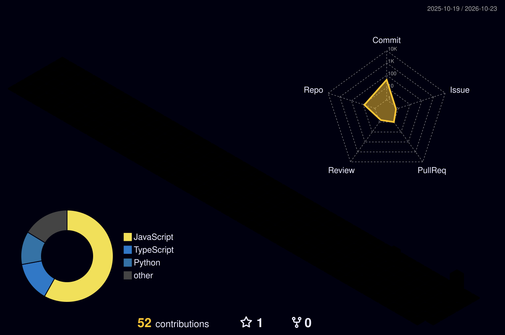

### Building thoughtful software, from idea to working product.

**Computer Engineering graduate • Pune, India • Open to software engineering opportunities**

---

### ◈ About me

I build **full-stack web applications and AI-powered tools** with a focus on usability, reliable architecture, and maintainable code. My work spans **React/TypeScript interfaces, Python backends, serverless systems, and applied machine learning**.

- **Currently building:** [NEXYRAL](https://nexyral.online), an AI-assisted React frontend builder and workspace.
- **Research:** Pest outbreak prediction for Kharif crops using machine learning; presented at **ICRTSET-2026**.
- **Background:** B.E. Computer Engineering / Computer Science, SPPU (2026); Python programming internship at Codsoft.
- **Exploring:** AI-assisted developer tooling, cloud infrastructure, and production engineering.

### ◈ Featured projects

<table>
<tr>
<td width="50%" valign="top">

#### ✦ [NEXYRAL — AI App Builder](https://nexyral.online)
**React · TypeScript · Cloudflare Workers · D1 · Firebase**

Turn natural-language requests into React frontend source, preview desktop and mobile layouts, refine generated code, restore saved versions, and export projects. Includes account authentication and a serverless workspace.

**[Live app ↗](https://nexyral.online)** · **[Source ↗](https://github.com/Mohsinpathan17/nexus-ai-platform)**

</td>
<td width="50%" valign="top">

#### ✦ [KrishiSetu — ML Pest Prediction](https://github.com/Mohsinpathan17/Krishisetu)
**Python · Scikit-learn · XGBoost · LSTM · Flask**

Machine-learning research and application for evaluating pest outbreak risk from environmental and agricultural features. Compared classification methods and presented the research at ICRTSET-2026.

**[Source ↗](https://github.com/Mohsinpathan17/Krishisetu)**

</td>
</tr>
<tr>
<td width="50%" valign="top">

#### ✦ [Websites With Punch](https://websiteswithpunch.com)
**React · TypeScript · Vite · Tailwind CSS**

Website for a web design and maintenance studio. Presents services, pricing, past work, and contact information through reusable components and responsive layouts.

**[Live site ↗](https://websiteswithpunch.com)** · **[Source ↗](https://github.com/Mohsinpathan17/websites-with-punch)**

</td>
<td width="50%" valign="top">

#### ✦ [Interactive Developer Portfolio](https://mohsinpathan.vercel.app)
**React · TypeScript · React Three Fiber · Vite**

Portfolio with interactive 3D elements, selected engineering work, a NEXYRAL case study, responsive design, and automated browser/logic checks.

**[Live portfolio ↗](https://mohsinpathan.vercel.app)** · **[Source ↗](https://github.com/Mohsinpathan17/portfolio)**

</td>
</tr>
</table>

### ◈ Technology stack

**Languages**  
    

**Web & infrastructure**  
      

**Data & ML**  
    

### ◈ Contribution city · 3D activity

<!-- Generated by the scheduled GitHub Actions workflow; appears after its first successful run. -->

### ◈ GitHub activity

---

**Have a project or engineering opportunity in mind?**

[Explore my work](https://mohsinpathan.vercel.app) · [See NEXYRAL](https://nexyral.online) · [Get in touch](mailto:mohsinpathan1058@gmail.com)

Built with curiosity, engineering, and a little visual flair.

